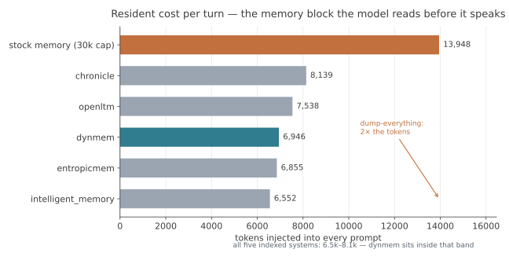
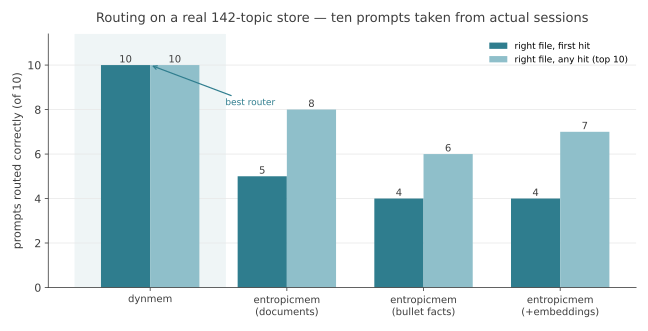
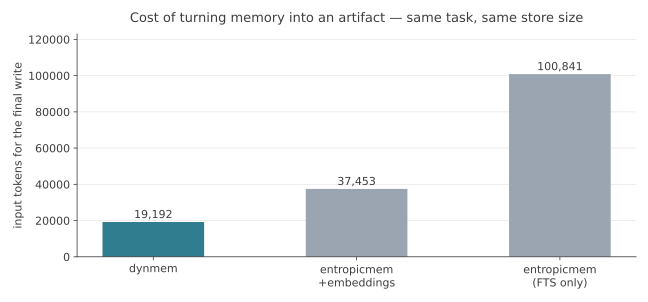
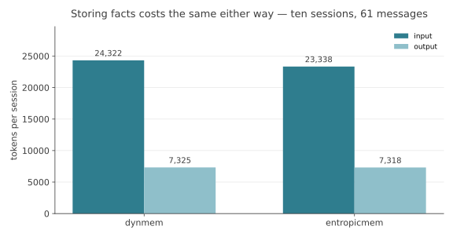
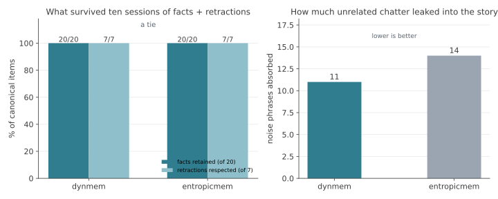
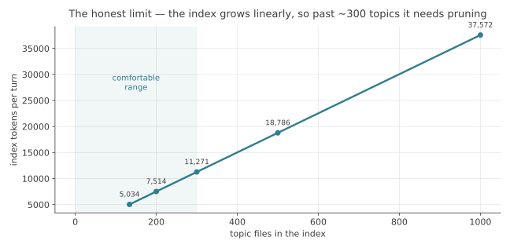
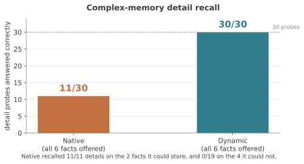
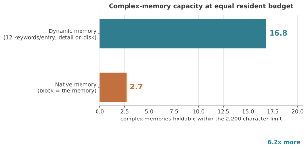
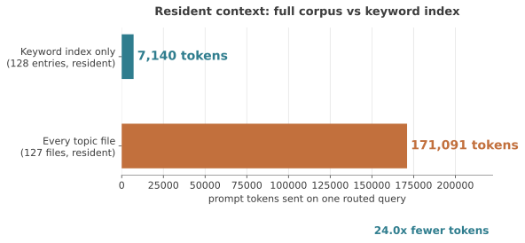

## Dynmem

**A keyword index in the prompt, the knowledge on disk, and a hook that keeps the two apart.**

Hermes' built-in memory has a hard cap: fill it and the agent starts losing memory. dynmem turns
`MEMORY.md` into a small routing table — one line of keywords per topic — and keeps the detail in
plain Markdown files the agent reads only when a line matches.

Measured on a real 142-topic store: **10/10 prompts routed to the right file, half the resident cost
of built-in memory, and the cheapest path from memory to written artifact** of any system tested.

<p align="center">
  
</p>

---

## Why this exists

Built-in memory is one file injected verbatim into every prompt. Two consequences:

- **It fills.** At the default cap you hold ~22 topics; the 142-topic store used in these benchmarks
  simply does not fit, and what overflows is silently compacted or refused.
- **It is paid every turn.** Every token rides in every request, relevant or not — **13,948 tokens
  per turn** measured here. dynmem keeps the resident part at **6,946** and puts the rest behind a
  lookup that costs nothing until it is used.

---

## How it works

```
MEMORY.md   always in the prompt — 134 topics in ~5k tokens
  # All memories are located in: /home/you/.hermes/memories
  telescope,mount,azimuth,dome,shutter,seeing   → observatory-mount.md
  sourdough,starter,hydration,proof,bake,oven   → sourdough-bake.md
  invoice,vat,quarter,ledger,receipt,deadline   → invoicing-quarterly.md
        │
        │  the model matches a line, then reads one file
        ▼
memories/*.md   on disk, never injected
  ## Related memories
  - when the question is about last winter's repairs → observatory-repairs.md
```

Three rules make it work:

1. **One fact, one home.** Detail lives in a topic file; the index only says where.
2. **One absolute path, once.** The plugin writes it into the header on first run, so entries stay
   bare filenames and the agent never has to search for the directory.
3. **Links, not copies.** A topic file may end with `## Related memories` — at most five conditional
   edges, followed only when the condition matches, never more than two hops.

`dynmem` enforces the format from the hook layer: no prose in `MEMORY.md`, no shell writes to
it, an intact header, and validated entries (Unicode arrow, bare filenames, 5–20 keywords).
`scripts/verify_index.py` checks the whole store, including Related edges.

---

## Measurements — November 2026

One box, Hermes v0.22.5, `deepseek-v4.1-flash`, a real **142-topic / ~200 KB** personal memory store
against five competitor memory systems installed from the same catalog. Raw data:
[`docs/benchmarks-2026-11-05.json`](docs/benchmarks-2026-11-05.json); charts generated by
[`scripts/make_charts_2026_11.py`](scripts/make_charts_2026_11.py).

### 1. Routing — does it find the right file?

Ten prompts taken from actual sessions, not synthetic questions. Each maps to one topic file.
Question: does the system surface that file first?

<p align="center">
  
</p>

- **dynmem 10/10 first hit, 10/10 in the top ten.**
- Best competitor **5/10** first hit, 8/10 in the top ten.
- Adding embeddings to the competitor moved first-hit accuracy by **zero** and top-ten by one prompt.
  Precision here comes from a curated index, not from vectors.

### 2. Resident cost — what every turn pays

<p align="center">
  
</p>

Every indexed system lands in the same **6.5k–8.1k** band; dynmem sits inside it at 6,946. The
built-in store costs 13,948 — twice as much, and it still cannot hold the corpus.

### 3. Write cost — turning memory into an artifact

Ten sessions of facts (61 messages) about one short story — characters, place, props, numbers,
deliberate retractions — then one prompt: *write the story*. Same store size for both systems.

<p align="center">
  
</p>

- **dynmem 19,192 input tokens** — five topic files read, nothing else.
- Best competitor **37,453** with embeddings, **100,841** without.

### 4. Ingest — storing facts is not the expensive part

<p align="center">
  
</p>

Per session: **24,322** input tokens for dynmem, **23,338** for the competitor. dynmem's advantage is
not writing — it is never having to distil.

### 5. Memory under load — ten sessions, retractions, noise

The store was already full (134 index entries / ~1,840 competitor facts) and every session was salted
with keywords from unrelated memories — `bicycle`, `taxes`, `sourdough`, `landlord`, `passport`,
`piano`. What had to survive: the facts, the retractions (“make the dog a cat”,
“cut Aunt Dagny”, “he is not her brother”, “Ivo must not die”, “no fire”, “don't sell the
lighthouse”), and the noise.

<p align="center">
  
</p>

- **20/20 canonical facts retained in memory — both systems.**
- **7/7 retractions respected — both systems.** No dog, no Kestrel, no Dagny, no brother, no death,
  no fire, no sale.
- The story still ran to length (1,047–1,075 words), and dynmem absorbed **11** noise phrases against
  the competitor's **14**.
- No unrelated real-memory fact leaked into either story.

### 6. The honest limit

<p align="center">
  
</p>

The index is linear: **~37 tokens per topic per turn**. 134 topics cost 5,034 tokens; 1,000 would
cost 37,572. Past roughly **300 topics** it needs pruning or archiving — that is what
[`scripts/dynmem-watchdog.py`](scripts/dynmem-watchdog.py) does. Files are free; the map is not.

---

## Scoreboard

| | dynmem | best competitor | built-in memory |
|---|---|---|---|
| Routing, first hit (10 real prompts) | **10/10** | 5/10 | n/a — store doesn't fit |
| Routing, top ten | **10/10** | 8/10 | n/a |
| Resident cost per turn | 6,946 | **6,552** | 13,948 |
| Write-step input tokens | **19,192** | 37,453 (with embeddings) | n/a |
| Ingest per session | 24,322 | **23,338** | 0 — no detail tier |
| Facts retained, 10 sessions | **20/20** | **20/20** | not measurable — cap |
| Retractions respected | **7/7** | **7/7** | — |
| Infrastructure needed | **none** | DB + 1.2 GB (CPU-only) to 5.4 GB (CUDA) embedding stack | none |

Installed footprint, measured on this box rather than estimated: a CUDA build of the embedding stack
is **5.4 GB** on disk — `torch` 2.15 (1.1 GB) plus 3.3 GB of `nvidia-*` CUDA-13 wheels plus `triton`
(0.9 GB) — and `transformers` + `sentence-transformers` add ~70 MB on top of the model weights. The
CPU-only wheel is the ~1.2 GB case. None of it is needed to run dynmem, which is the point of the row.

**Where dynmem wins:** routing precision, the cost of *using* what it stored, and needing nothing
running — no database, no embedding model, no server. Plain files you can `grep`, `diff` and back up.

**Where it does not:** resident cost is mid-pack (6,946 vs 6,552), ingest is a wash, and the index
grows linearly. On a weak model the routing advantage narrows sharply — a free flash-class endpoint
took 8 calls / 66.6k tokens where a strong model takes 2–3 calls / 14.6k — because the model has to
follow the read rule. dynmem is a system for capable models.

---

## Earlier rounds: the cap is a hard cutoff, not a gradient

Six structured memories — a migration policy with exceptions and a named approver, an
incident-severity rule with timing thresholds, a deploy order with canary gates — probed for every
detail, 30 probes per system, clean containers, memory the only possible source.

| | Built-in memory | dynmem |
|---|---|---|
| Detail probes answered | **11 / 30** | **30 / 30** |
| Complex memories held | 2 of 6 | **6 of 6** |
| Resident cost to hold them | 1,615 chars | **503 chars** |

<p align="center">
  
</p>

Built-in memory kept 2 of 6 and **refused the other 4 outright**. On the two it held it recalled every
detail (11/11); on the four it could not store it recalled **0 of 19**. A memory is either fully
present or entirely absent, and which one depends only on arrival order.

At an equal resident budget the capacity difference is **6.2×** (2.7 vs 16.8 complex memories per
2,200 chars, at a conservative 12-keyword rate):

<p align="center">
  
</p>

Method and limits: [`docs/complexity.md`](docs/complexity.md) · [`docs/cohort-50.md`](docs/cohort-50.md).
Reproduce without containers or API keys:

```bash
python3 benchmarks/scripts/run_complexity.py --verify-only
# built-in : 11/30
# dynmem   : 30/30
```

## Live-corpus check: 128 entries, real memory

The runs above use synthetic topics. This one uses the actual four-month-old memory: 127 topic files,
128 index entries, no fixtures.

| | Full corpus | Keyword index |
|---|---|---|
| chars | 574,243 | **22,382** |
| prompt tokens per routed query | 171,091 | **7,140** |

<p align="center">
  
</p>

**24× fewer prompt tokens per query**, and 28 of 30 natural-language questions routed to the correct
file first try. That run used a free flash-tier model as a floor, so read the routing number as a
lower bound: [`docs/live-index-retrieval.md`](docs/live-index-retrieval.md).

---

## Governance: the dynmem plugin

A self-editing memory is both the feature and the failure mode.

| Failure mode | Guard |
|---|---|
| Index clobbering | `replace` must match exactly one line; never drops more than one entry |
| Format drift | Unicode `→`, bare `*.md` targets, 5–20 keywords, no prose; rejections carry the fix |
| Path tricks | Bare filenames only — no paths, no `../` |
| Write-vector bypass | `write_file`, `patch`, redirects, `tee`, `sed -i` blocked when aimed at the index |
| Audit lockout | Read tools always pass (path-sharing with `write_file` was a real bug, fixed and regression-tested) |
| Orphan rot | Validator flags unreachable files, dead pointers, broken Related edges and cycles |
| Stale installations | `__init__.py` delegates to `plugin.register`, so a hook cannot be silently unregistered |

`memcheck` (1.6.0) closes the last gap: routing decisions leave no trace, so it asks the model for a
tagged self-report on the first four turns, validates every claim against the index and the topic
file, and discards what does not check out. `python3 scripts/memcheck_report.py`.

---

## Install

**From the plugin catalog** (once the entry is merged): `hermes plugins install dynmem` —
installs this repo pinned at a reviewed commit.

**No core patch.** Stock Hermes joins entries with a `§` line, so the whole header is one entry and a
single `remove` would delete it. The plugin refuses any `remove` / `replace` / `patch` whose
`old_text` lands inside the header, and treats `§` as a separator it ignores, so the index works on an
unmodified store. `scripts/patches/0001-flat-memory-separator.patch` is background only.

1. **Plugin** — copy `plugin/dynmem/` to `~/.hermes/plugins/`, enable in `config.yaml`.
2. **Skill** — copy `skill/` to `~/.hermes/skills/system-administration/dynamic-memory/`.
   `skill-install/` holds the fresh-box setup skill.
3. **Adopt the format** — restructure the index into `keywords → file.md` lines, then:
   ```bash
   python3 scripts/verify_index.py ~/.hermes/memories/MEMORY.md   # exits 0 = clean
   ```
   Or start from `examples/MEMORY.template.md`: the plugin fills the memories path and deletes the
   placeholder lines on the first real write.
4. **Verify the wiring, not just the logic:**
   ```bash
   python3 scripts/test_hook_cases.py
   hermes plugins doctor ~/.hermes/plugins/dynmem   # 4 hooks registered
   ```
5. **Optional lifecycle** — `python3 scripts/dynmem-watchdog.py --dry-run`, then schedule it.

## Hermes compatibility

This project rides on Hermes' native memory file, so updates can break it. Verified against v0.21.3
and v0.22.5. Native behaviours that force workarounds: the hardcoded `§` entry delimiter, no routing
instruction in the injected block, the default cap, `read_file`/`write_file` sharing a `path`
argument, and the prompt view disagreeing with the file view on separators. After upgrading:

```bash
hermes plugins doctor ~/.hermes/plugins/dynmem && python3 scripts/test_hook_cases.py
python3 scripts/verify_index.py ~/.hermes/memories/MEMORY.md
```

## Also in this repo

- **Block map** — [`docs/blocks.md`](docs/blocks.md): seven components, who may write `MEMORY.md`,
  dependency arrows, what breaks when each moves.
- **Claims and limits** — [`docs/readme-positives.md`](docs/readme-positives.md): every benefit here
  with its measurement and the places competitors still lead.
- **Porting** — nothing here is Hermes-specific: an index file plus a routing rule works in Claude
  Code, OpenClaw, OpenHands or any file-tool agent. The plugin is hardening, not a requirement.
- **Prior art** — OpenHands keyword-triggered skills, Claude Code auto-memory, pi-memory-tree,
  A-MEM/MemInsight, mem0/Cognee/Letta/Zep. This adds set-level scoring, model-side fuzz over a literal
  index, hook-enforced governance and tested tooling in one drop-in package.

```
plugin/dynmem/   the enforcement plugin
skill/                  skill + diagnostic references
scripts/                validator · watchdog · hook tests · chart generator
examples/               synthetic demo index, topic files, archive
docs/                   architecture · benchmarks · charts · raw results
benchmarks/             fixtures, runners, reproduction report
```

## Limitations

- Single-run measurements on one host, one model, one store. Differences under ~10% are noise.
- The ten routing prompts were selected by index overlap, which favours dynmem; a neutral sample
  would lower its score.
- No semantic matching: a prompt whose words never touch an index line will not route. Curate symptom
  vocabulary, not just system vocabulary.
- Routing quality is model-dependent; the index instructs, only the plugin enforces.
- The guard needs Hermes hook support. On a stock store the plugin protects the index but does not
  create the flat format.
- Designed for tens to low hundreds of topics. Past ~300, prune or split by profile.

## License

Apache-2.0. **hermes-dynamic-memory by ockentap** —
https://github.com/ockentap/hermes-dynamic-memory
Redistributors must retain LICENSE and NOTICE and credit the project. Issues and PRs welcome —
porting notes, validator edge cases and benchmark results especially.
