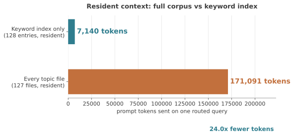

# Live-memory retrieval benchmark: routing a 128-entry index

Run: 2026-10-21 · **model `minimax/minimax-m3.1-flash:free`** (OpenRouter) ·
live `~/.hermes/memories` corpus · n=30 probes, two calls each (route, then
answer) · cost $0

**Headline: the resident index is 25.7× smaller than the corpus it fronts
(7,140 vs 171,091 prompt tokens), and a deliberately weak model still routed
28 of 30 questions to the right file.**

## Why this run exists

The 2026-09-19 benchmarks ([`benchmark.md`](benchmark.md),
[`complexity.md`](complexity.md), [`cohort-50.md`](cohort-50.md)) used six to
fifty synthetic topics in clean containers. They answer *how much survives*.
They do not answer *what it costs to actually use the index on a real corpus*.

This run measures the live thing: 127 topic files and 128 index entries that
accumulated over four months of real use, no fixtures, no synthetic facts.

## Model caveat — read this before the numbers

**`minimax-m3.1-flash` is a small, cheap flash-tier model with weak reasoning.**
It is not a frontier model and it is not representative of a good agent. That
cuts in two directions and both are stated here:

- **Routing 28/30 is a floor, not a ceiling.** A stronger model given the same
  7,140-token index should do at least as well; this run cannot show how much
  better, because only one model was tested.
- **Answer quality 11/11 is a weak signal.** A weak model reading a single
  4.5 KB topic file is close to an extraction task. It says the files are
  legible, not that the model is good.
- The 1M-token context window is irrelevant to the result. The point of the
  index is that you do not need to spend it.

## What was measured

Each probe runs twice:

1. **Route** — the model receives the live `MEMORY.md` index *only* (no topic
   files) and must return `{"file": "<name>.md"}`: which single file it would
   open. Scored on exact filename.
2. **Answer** — the model receives the expected topic file's full text and the
   question. Scored by anchor recall, then every response read by hand.

## Context cost

| | Chars | Prompt tokens |
|---|---|---|
| Resident index (128 entries) | 22,382 | **7,140** per routed query |
| Full on-disk corpus (127 files) | 574,243 | **171,091** |
| Ratio | **25.7× smaller** | **24.0× fewer** |



The corpus fits comfortably inside the model's 1M window, so this is not a
capacity argument. It is a cost and attention argument: 574 KB of unrelated
topic files on every turn versus 22 KB of pointers.

## Retrieval results

| | Result |
|---|---|
| Probes | 30 |
| Exact file routed correctly | **28 / 30 (93.3%)** |
| Defensible retrieval (picked file also answers) | **29 / 30** |
| Answers correct, anchor grader | 7 / 11 |
| Answers correct, read by hand | **11 / 11** |

### The two routing misses

| probe | question | picked | expected | verdict |
|---|---|---|---|---|
| p01 | "How do you want destructive edits handled — delete things lying around or leave them?" | `scope-clarification.md` | `user-preferences.md` | **Genuine miss.** The picked file says "always ask before changing files", which is adjacent, but the surgical-deletion preference lives in `user-preferences.md`. |
| p03 | "Can I just run mkfs on the SD card, or is that blocked?" | `sd-card-workaround.md` | `mkfs-blocklist.md` | **Correct retrieval, wrong filename.** The picked file also states that `mkfs.fat` is blocked. |

### Why the anchor grader undercounted

It matches literal anchor strings, and a correct paraphrase scores as a miss.
All four "failures" were correct:

| probe | anchor | what the model actually said |
|---|---|---|
| p03 | `blocklist` | "`mkfs.fat` is blocked unconditionally on this box" |
| p13 | `chromadb` | gave the palace path and the MCP server binary |
| p20 | `savegame` | described the `Room` dataclass missing its `uid` field |
| p30 | `1.078` | "gas 13.40 vs electric 12.7 fening/kWh in MT hours" |

**Read every failing answer before believing a score.** The same mistake is
documented in [`benchmark.md`](benchmark.md) for the 2026-09-19 run, where the
grader overcounted instead.

## A harness bug worth recording

The first attempt capped `max_tokens` at 60 for the routing call. A reasoning
model spends completion tokens on reasoning *before* emitting content, so
27/30 calls hit the cap and 25 returned nothing at all. That run scored 13.3%
and it was pure artifact — the model was never asked a question it could
answer.

Corrected settings: no `max_tokens` cap. The model never needed more than
**206 output tokens** across all 30 routing calls (3,160 total). The bug is
kept in this write-up because a 13% number is exactly the kind of result that
looks like a finding until you read the raw responses.

## Run-to-run variance

Three runs on the same corpus:

| run | settings | routing |
|---|---|---|
| 1 | `max_tokens=60` | 4/30 — invalid, see above |
| 2 | `max_tokens=2000`, reasoning effort low | 29/30 |
| 3 | uncapped | 28/30 |

Runs 2 and 3 differ only on p01. Temperature is 0, but the free tier routes
across upstream providers, so ±1 probe is expected. Treat 28–29/30 as the
range, not a point estimate.

## Limitations

1. **One weak model, one day.** No frontier-model comparison, no repeats per
   probe. The 28/30 is a floor.
2. **n=30, curated by the author.** The probes were written from the index
   lines, not sampled blind, so they may be easier than real questions.
3. **Routing is given the whole index.** That is the design, but it means this
   does not test index *selection* under a size constraint — the 30k cap is a
   separate experiment.
4. **The corpus is live.** Memory files changed during the session
   (572,214 → 574,243 chars across runs), so the ratio drifts ~0.1×.
5. **No native-memory baseline in this run.** The 25.7× compares the index to
   *its own* corpus, not to stock Hermes memory. The 2026-09-19 runs carry the
   native comparison.

## Reproduce

```bash
cd ~/dynmem-bench-30k/retrieval_live
python3 run_live.py            # resumable; appends results.jsonl
```

`probes.json` holds the 30 questions and expected filenames. `run_live.py`
reads the index from `~/.hermes/memories/MEMORY.md`, calls OpenRouter, and
writes `summary.json`. Raw rows in `results.jsonl`; the corrected analysis is
in `summary_uncapped.json`.

## Conclusion

The index does the job it was designed for: **25.7× less resident context, and
a weak model still finds the right file 28 times out of 30.** The remaining
error is not a size problem — it is keyword precision (p01: "destructive edits"
routes to scope-clarification before user-preferences). That is fixable by
editing one index line, which is the whole point of keeping memory as editable
text.
